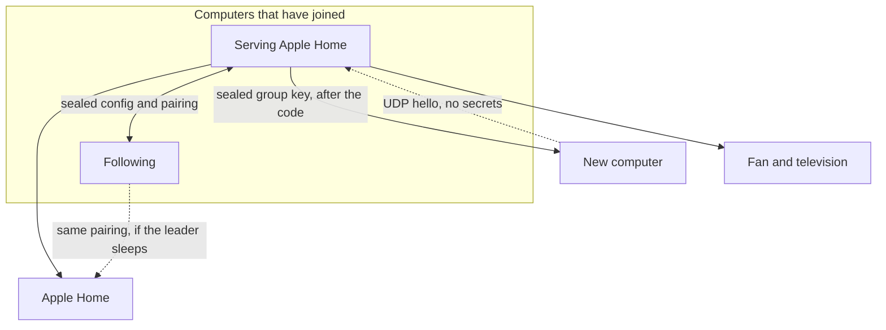

<p align="center">
  
</p>

<h1 align="center">Hearth</h1>

<p align="center">A local HomeKit bridge for devices that do not speak HomeKit.</p>

Hearth is one process on your network. It advertises a single bridge, and each device is a connector behind that bridge. After a device is paired, hearth does not use that device's cloud. Home, scenes, and automations then see real accessories. Shortcuts and the manufacturer's app cannot do that.

An Apple TV or HomePod is still the hub for control away from home. It does not replace this process. The machine running hearth has to stay awake, on the same network as the devices.

## Run it

There are two ways. Both run the same `hearth` process. Use one of them, not both: a launch agent will start the bridge again the moment the menu bar stops it.

### Mac

The menu bar app is the straightforward way. It has no Dock icon. The menu is where you start and stop the bridge, add a device, approve another computer, turn on start at login, and update the app from a GitHub release. The panel reads a status file the bridge already writes. It does not open a second connection to the fan or the television.

The app is built for Apple silicon. Download `Hearth-v<version>-macos-arm64.zip` from the latest release, move `Hearth.app` to `/Applications`, and open it. To build it yourself, on a Mac:

```sh
cargo build --release
macos/build.sh
open macos/Hearth.app
```

Start at login is a switch in the menu. Quit closes the menu and leaves a running bridge alone.

### Linux, and any machine without the menu

Install the command-line service. Once the repository is public:

```sh
curl -fsSL https://raw.githubusercontent.com/WeixuanZ/hearth/main/install.sh | sh
```

That downloads the latest release for this machine, checks it against `SHA256SUMS`, and puts `hearth` in `~/.local/bin`. It does not work while the repository is private: GitHub will not serve the script or the binaries without a login. To build from this checkout instead:

```sh
cargo install --path .
```

Releases cover Linux x86_64, Linux aarch64, macOS Apple silicon, and macOS Intel. The menu bar app is Apple silicon only. On Intel, use the command.

Keep it running with a user service. The machine must not sleep, or Home shows the accessories as not responding.

```ini
# ~/.config/systemd/user/hearth.service
[Unit]
Description=Hearth
After=network-online.target
Wants=network-online.target

[Service]
ExecStart=%h/.local/bin/hearth run
Restart=on-failure
RestartSec=3

[Install]
WantedBy=default.target
```

```sh
systemctl --user enable --now hearth.service
sudo loginctl enable-linger "$USER"
```

`enable-linger` keeps the service up when you are logged out. On a Mac without the menu bar, `contrib/com.weixuan.hearth.plist` is the same idea. Edit the two paths in that file before loading it.

## Devices

Connectors included now. More can be added without a second bridge.

| Device | Connection | In Home |
|---|---|---|
| Dyson Purifier Hot+Cool Formaldehyde (HP09) | The fan's own MQTT, after one MyDyson login | One purifier: power, auto, 10 speeds, oscillation, heat to 1–37 °C, air quality, PM2.5, PM10, humidity, temperature, HEPA life, and switches for night, focused jet, keep sensing, and each oscillation sweep |
| Samsung The Frame, 2024 (LS03D, including the 65") | The TV's own websocket and IP Control, not SmartThings | One television: power, TV and HDMI 1–4 as inputs, remote, volume, art brightness. Art mode is a tile of its own |

Home has no formaldehyde sensor. Formaldehyde, VOC, and NO₂ are folded into the air-quality rating. The fan reports VOC and NO₂ as an index, not a density.

## One bridge, several computers

Homebridge is one process on one computer. Install it again and Home sees a second bridge, with a second pairing code. Hearth is the same bridge on every computer that has joined. One of them serves Apple Home. If that one sleeps or is closed, another starts serving, and Home does not ask for the code again. A machine that is already serving keeps the job. Any of them can add or remove a device. The newer edit wins, so the clocks should be roughly right.



A new computer shows a six-digit code. Type that code on a computer already in the group, then confirm on the new one. Until both of those happen, nothing is shared: no device list, no pairing, no keys. The two sides agree the code with a one-time key exchange. A different code means someone is in between, and the join stops.

After that, the computers find each other with a UDP broadcast on port 47620, twice a second. That packet is only a hello: who is serving, and a hash that the config changed. It is signed, and it is not encrypted, because it holds no secrets. When a hash differs, the machine that is behind opens a TCP connection to that one computer on port 47621 and pulls the device list and the HomeKit pairing. Those messages are sealed with the group key.

A firewall has to allow those two ports between the computers. The broadcast stops at the router, and it does not cross a VLAN. Wi-Fi that isolates clients from each other will hide the computers from each other.

This only works when the machines are not each already paired as a different bridge. If they are, the menu says so and leaves both alone. Forget Home on one of them, then start it again.

From the menu, approve, confirm, leave, or start a separate group. From the command line:

```sh
hearth cluster approve 123456
hearth cluster confirm
hearth cluster deny
hearth cluster leave
hearth cluster start
```

## Pair a device

A fan. `login` asks for the MyDyson password and the code Dyson emails. It stores the fan's local password, not the account password.

```sh
hearth dyson login --email you@example.com --country GB
```

A Frame. Turn the TV on, out of art mode. On the TV, allow device connection and Power On with Mobile (Settings → General → External Device Manager, and Connection), and turn on IP Remote (Settings → General → Network → Expert Settings).

```sh
hearth frame pair
hearth frame pair --host 192.168.1.40
```

Press Allow twice: once for the remote, once for IP Control. IP Control is what picks an input and powers the TV fully off. Without it, inputs fall back to remote keys, which newer firmware ignores. Both stay local.

Check, then start:

```sh
hearth status
hearth run
```

On a Mac with the menu bar, add the device from the menu instead. `hearth run` is what the menu starts for you.

## Add it to Home

```sh
hearth pin
```

prints the 8-digit code. In the Home app: **Add Accessory → More options… → Hearth**.

Config is `~/.config/hearth/config.toml`, mode 0600. The group key is `cluster.json` next to it, also mode 0600, and it is never copied to the other computers inside the config. An existing `~/.config/dyson-home` is copied on the first run, including the HomeKit pairing. If Home still shows the old bridge name, remove it and add Hearth.

`bridge_id` in the config is hashed into the HomeKit device id. Leave it alone, or Home treats the bridge as a new accessory.

**Rename a device.** Names come from the device or its app. To change one:

```sh
hearth rename "Old name" "New name"
```

then restart the bridge. Home picks the name up on its next refresh, or at once when the bridge is added again. Avoid naming a device after its room: Home hides a room's name at the start of an accessory's name.

**Add it again.** Remove the bridge in Home while it is running, and it shows up to add again. If it was removed while the bridge was stopped, the bridge still thinks it is paired and stays hidden. The menu bar says "Paired with Home" then. Choose Forget Home there, tap again to confirm, and add it as above. Without the menu bar, stop the bridge, run `hearth unpair`, and start it.

**Changes reach Home on their own.** The bridge remembers the shape of its accessories. When a device, a switch, or a name changes, it tells Home to fetch the new set on the next start.

## Known limits

**Heat.** Turning heat on turns the fan on, since it heats only while it blows. The fan stops heating when the focused jet is turned off, and Home shows the heater go off. Some firmware also ignores heat commands that did not come from the infrared remote. Set `heating = false` on that device to hide the control.

**Oscillation.** Home has no angle, so the purifier has a switch for each of the Dyson app's sweeps: 45, 90, 180 and 350 degrees, centred where the fan points. Home's own Oscillate keeps the range set in the Dyson app, or sweeps 90° if that range is narrower than 30°.

**Fan connection.** Set `host` on the fan if it does not announce itself on the network. The fan serves one live session, so stop the bridge before `hearth status` or `hearth dyson set`.

**The Frame.** Power is the TV's own on and off, and the inputs are TV and HDMI 1–4. Art mode is a tile of its own: Home shows a TV as power and an input picker only. Arrows, select, back and volume are in Control Center's remote, which keeps one connection to the TV open, so keys land at once. With IP Control, power and inputs go through it, and Home shows the input the TV is on. An input with nothing plugged in is refused. Without it, off holds the power key as the remote does, since a 2024 Frame ignores the power-off key, and on from standby is one press. Pairing and the art channel both need the panel awake.

To try a device without Home, the way Home drives it:

```sh
hearth dyson set swing 180
hearth frame power off
hearth frame art on
hearth frame input 2
hearth frame key KEY_MENU
```

## Development

`hearth run` is the whole service. It listens for other copies of itself, decides whether this machine should serve Apple Home, and only then starts the HomeKit server. A follower does not advertise a bridge.

| Path | What it is |
|---|---|
| `src/main.rs` | The command line |
| `src/cluster.rs` | Membership, who serves, join, and the sync loop |
| `src/cluster/wire.rs` | The frame around every message |
| `src/cluster/crypto.rs` | The group key, the handshake, and the seals |
| `src/bridge.rs` | The HomeKit server. The leader only |
| `src/config.rs` | `config.toml`, and merging two copies |
| `src/status.rs` | `status.json`, which the menu reads |
| `src/dyson/`, `src/frame/` | The connectors |
| `macos/` | The menu bar app, SwiftUI |
| `vendor/hap/` | The HomeKit protocol library |

On disk, under `~/.config/hearth/`:

| File | What it is |
|---|---|
| `config.toml` | Bridge name, pairing code, devices |
| `homekit/` | The HomeKit pairing |
| `cluster.json` | The group key. Not part of the synced config |
| `status.json` | What the menu shows |
| `hearth.sock` | Menu commands on this machine only, mode 0600 |

### Messages

Every message between two hearths is one frame: a version byte, a kind byte, a 4-byte length, then a body. The body is JSON, parsed with serde. There is no hand-written parser. File bytes ride inside that JSON as base64, because a HomeKit directory is small.

Hellos go out as a UDP broadcast to `255.255.255.255` port 47620. That is a broadcast, not a multicast. Once a computer has joined, the hello is signed with HMAC-SHA256. A stranger can read it and still cannot forge it.

The device list and the pairing go over TCP port 47621. They are sealed with ChaCha20-Poly1305. The group key is not used raw. HKDF splits it into a key for hellos and a key for state. Each seal starts with a random 12-byte nonce, and the kind of message is mixed into the tag, so a state message cannot be replayed as something else. A flipped byte does not open.

A computer joins by sending a one-time X25519 public key. Both sides derive the same six-digit code from the shared secret. The existing computer shows the code, someone types it, and the new computer confirms. Only then is the group key sealed and sent. The handshake keys are thrown away.

The menu talks to the process on the same machine through the Unix socket. That socket is not encrypted. It never leaves the computer.

### Adding a connector

A connector is a module under `src/` and a `kind` in the config. It borrows a block of HomeKit accessory ids (`aid`; the fan and the Frame use one each) and adds its accessories in `src/bridge.rs`. The bridge does not know how a device works, and the connector does not know which machine is serving.

```toml
[[devices]]
kind = "frame"
aid = 6
name = "The Frame"
model = "QE65LS03D"
host = "192.168.1.40"
mac = "aa:bb:cc:dd:ee:ff"
token = "…"
```

### Build and test

```sh
cargo fmt --check
cargo test --locked
cargo clippy --locked --all-targets -- -D warnings
```

Pushes to `main` and pull requests run those, and compile the menu bar on macOS as well. The menu bar is Swift, not Rust: `macos/build.sh` compiles it with `swiftc` and signs it ad hoc, which is required on Apple silicon.

### Releases

A release is a tag that matches the version in `Cargo.toml`. For 0.2.0 the tag is `v0.2.0`. The build publishes the binaries, the menu bar app, and `SHA256SUMS`. The install command uses those files. Actions artifacts from the same run expire and are not the install source.

```sh
git tag v0.2.0
git push origin v0.2.0
```

### Libraries

`vendor/hap` is [ewilken/hap-rs](https://github.com/ewilken/hap-rs) `v0.1.0-pre.15` (MIT/Apache-2.0), with two changes. It looks up the machine's address through `if-addrs`, because the original pair of crates both try to link the same system library and no longer build. The television and input-source services include their linked service list, which that crate left out, so Home can show Art and the HDMI sockets as inputs.

Messages use `serde` and `serde_json`. The seals use `chacha20poly1305`, `hkdf`, `hmac`, and `x25519-dalek`. Comparisons of the join code use `subtle`, so they do not stop at the first wrong digit.
