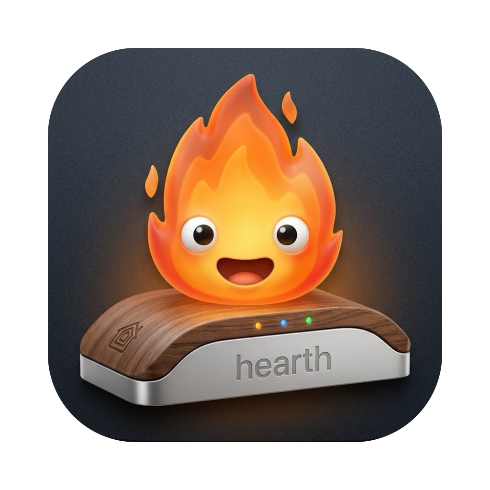
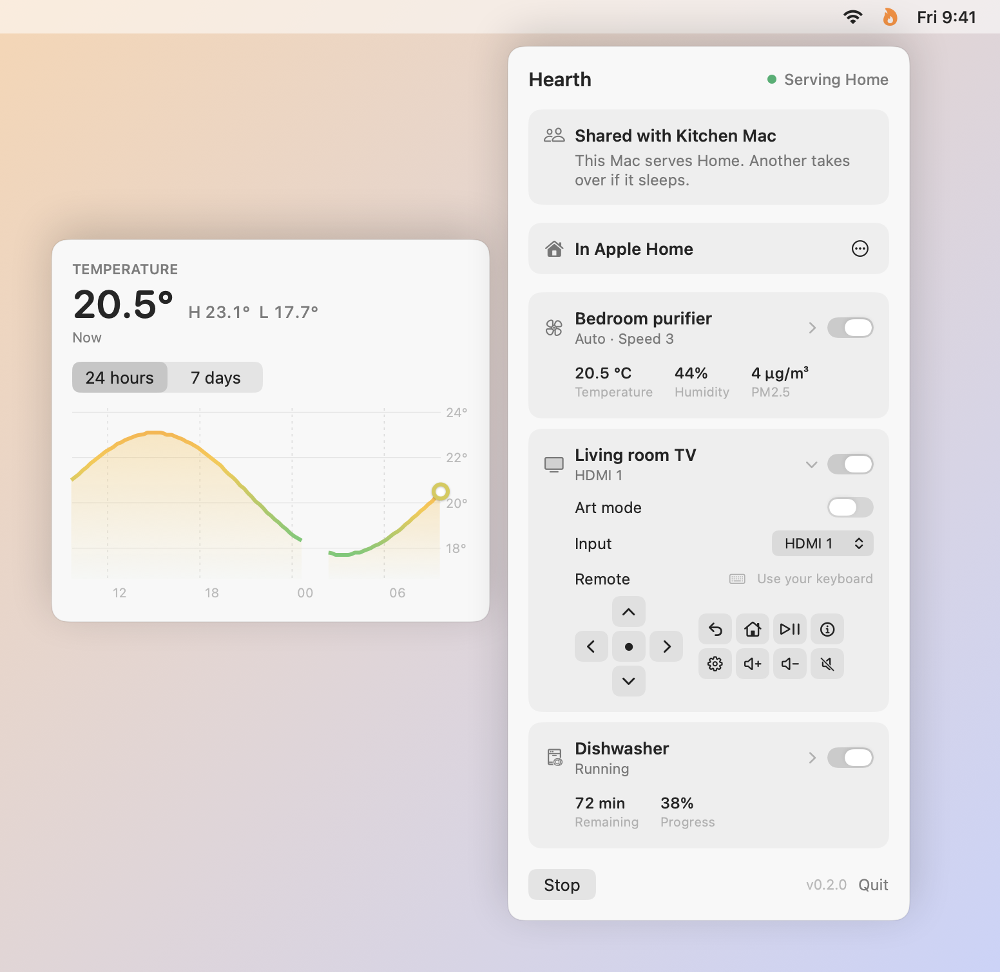
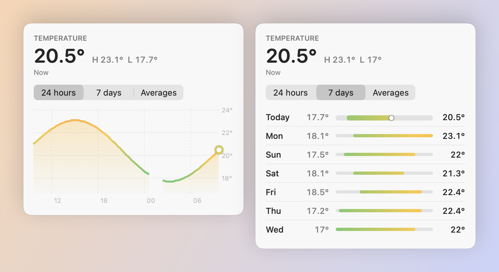
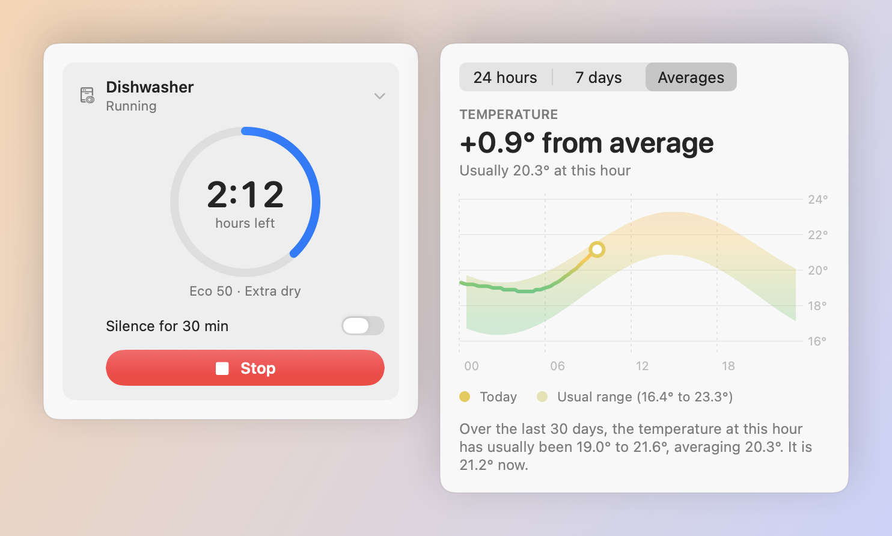
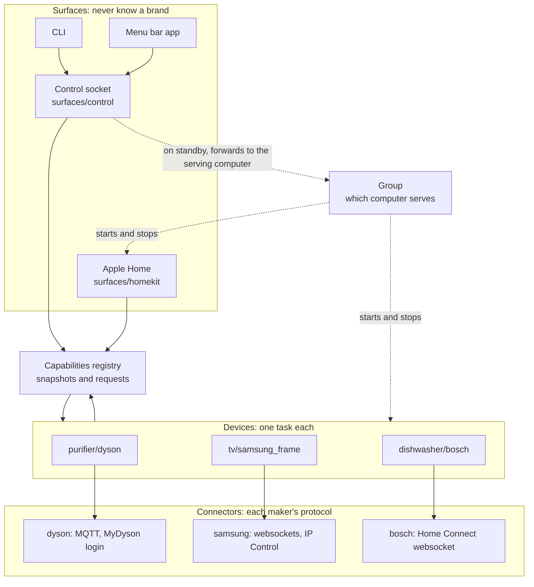
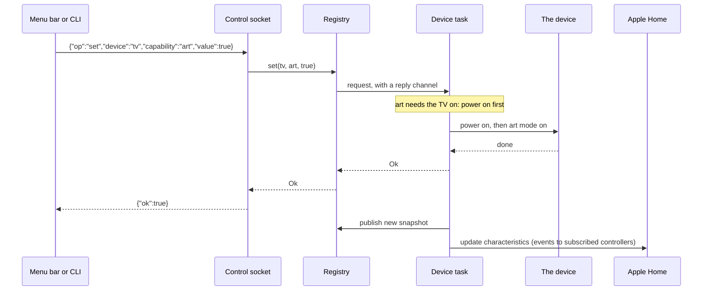
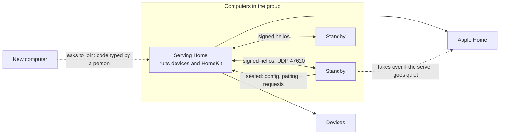
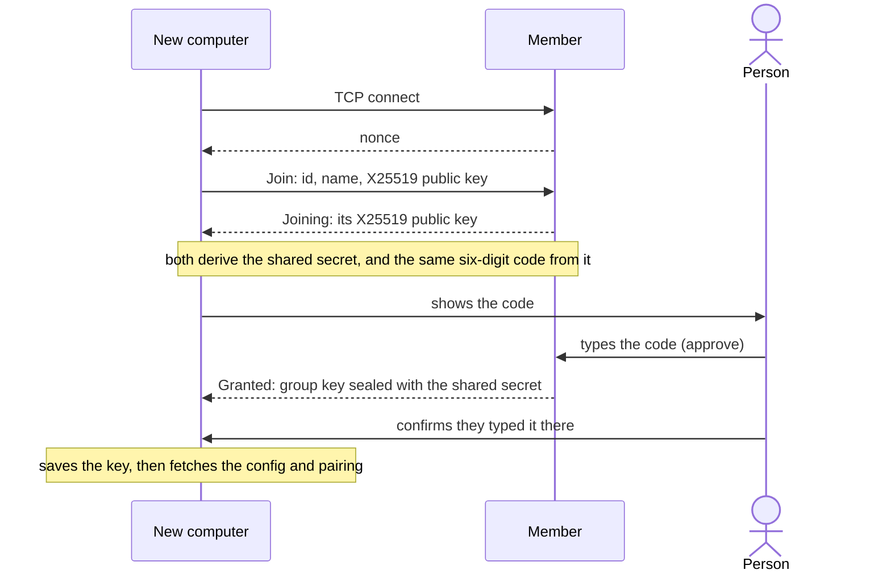
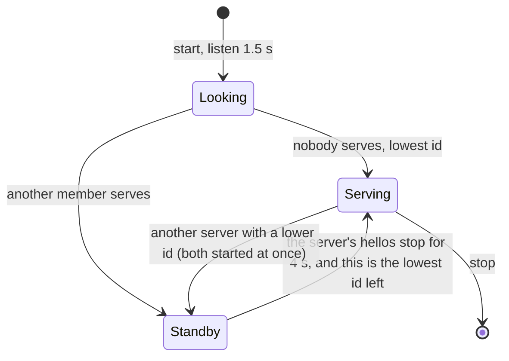

<p align="center"></p>

<h1 align="center">hearth</h1>

<p align="center">A local, extensible bridge from devices without HomeKit to Apple Home,<br>shared by every computer in the house, with a menu bar, a CLI and an API for scripts and agents.</p>

hearth is generic. Every device describes itself as a few **capabilities**: power, switches, choices, levels, readings and keys. Apple Home, the menu bar, the CLI and the control socket all work from those, so they work for any device, and adding a new one means teaching hearth a protocol, not building new UI. Devices are reached directly on your network, never through the maker's cloud once set up.

**One bridge, several computers.** Homebridge is one process on one computer: install it again and Home sees a second bridge with a second code. hearth is the same bridge on every computer that has joined. One of them serves Apple Home; if it sleeps or is closed, another takes over within seconds as the same bridge, and Home does not notice. Any of them controls every device. An Apple TV or HomePod is still the Home hub for control away from home.

<p align="center">
  <picture>
    <source media="(prefers-color-scheme: dark)" srcset="docs/screens/menu-bar-dark.png">
    
  </picture>
</p>

## Supported devices

| Kind | Device | Reached over | Capabilities |
|---|---|---|---|
| Purifier | Dyson Purifier Hot+Cool Formaldehyde (HP09), and other Dyson purifiers | The fan's own MQTT, after one MyDyson login | power, auto, speed, oscillation, sweep, night mode, jet focus, continuous monitoring, heat, heat target, temperature, humidity, PM2.5, PM10, formaldehyde, filter life |
| TV | Samsung The Frame, 2024 (LS03D) | The TV's websocket and IP Control, not SmartThings | power, art mode, input (TV, HDMI 1–4), art brightness, remote keys and volume |
| Dishwasher | Bosch dishwashers on Home Connect, including the slimline SPV2HKX42G | The dishwasher's own websocket, after one Home Connect sign-in | power, programme, the machine's options, remaining time, progress, and what a programme will use |
| Anything on MQTT | Lights, switches and sensors through an MQTT broker: Zigbee2MQTT, Tasmota, ESPHome, or your own | The broker, MQTT 3.1 | whatever its config lists: power, switches, levels, choices, readings and states |

As many of each as you have. In Apple Home they become purifiers, televisions each with an Art mode tile, a dishwasher as switches with a door, a leak and a cycle sensor beside it, and MQTT devices as lights, switches and sensors. New kinds and models plug in without touching the rest; see [Adding a device](#adding-a-device).

## Install

**Mac.** Download `Hearth-<version>-macos-arm64.zip` (Apple silicon) or `-x86_64.zip` (Intel) from the latest release, move `Hearth.app` to Applications, and open it. It lives in the menu bar and keeps itself up to date. Or build it: `cargo build --release && macos/build.sh && open macos/Hearth.app`. The first time, macOS asks whether Hearth may use the local network: allow it, or it cannot reach the devices (System Settings › Privacy & Security › Local Network; `hearth doctor` says so when it is off). A build signed ad hoc is new to macOS each time, so it asks again; `scripts/signing-identity.sh` makes a signing identity of your Mac's own, once, so builds keep the permission.

**Command line**, on Linux or a Mac:

```sh
curl -fsSL https://raw.githubusercontent.com/WeixuanZ/hearth/main/install.sh | sh
```

downloads the latest release for this machine (Linux x86_64 or aarch64, macOS Apple silicon or Intel), checks it against `SHA256SUMS`, and puts `hearth` in `~/.local/bin`. Or `cargo install --path .` from a checkout.

## Set up

**Add a device from the menu bar**: the `+` beside Start, then choose it and follow its steps. Or in the terminal, `hearth add dyson`, `hearth add frame` or `hearth add bosch`, which asks the same steps. A device added on any computer in the group reaches all of them.

**A Dyson purifier.** You sign in to MyDyson once, with your password and the code Dyson emails; hearth keeps only the fan's local password. It is the one time hearth talks to Dyson. In the terminal the flags answer the questions: `hearth dyson login --email you@example.com --country GB`.

**A Samsung Frame.** Turn the TV on, out of art mode. On the TV, turn on device connection and Power On with Mobile (Settings → General → External Device Manager, and Connection), and IP Remote (Settings → General → Network → Expert Settings). Then press Allow twice: once for the remote, once for IP Control, which picks inputs and powers the TV fully off. Nothing leaves your network.

**A Bosch dishwasher.** It has to be on the home Wi-Fi, already set up in the Home Connect app. You sign in once on Home Connect's own page. From the menu bar, the browser then asks to open Hearth, which takes the sign-in from there; in the terminal, the page ends on an `hcauth://` address to paste back. The account password is not saved; the dishwasher's local key is, and after that hearth talks only to the dishwasher. Starting a programme needs Remote Start on the dishwasher. Reading it does not.

**Anything on MQTT.** A light, a switch or a sensor that talks through an MQTT broker, like Mosquitto beside Zigbee2MQTT, needs no code: `hearth add mqtt` asks where the broker is and the topics for the common cases, and anything more goes in its table in `config.toml`. Each control is a capability, read from the topic it reports on and set on the topic it is set on; with a `field`, messages are JSON and the value is that field (a dotted path), as Zigbee2MQTT sends them. A light becomes a lightbulb in Home, its brightness over its own range; a sensor becomes Home's temperature, humidity and air-quality sensors, with a door (`role = "contact"`) or a leak as tiles Home notifies for.

```toml
[[devices]]
kind = "mqtt"
key = "desk-lamp"            # its id for good: mqtt:desk-lamp
name = "Desk lamp"
category = "light"           # light, switch, sensor or other
host = "10.0.0.5"            # the broker; port 1883, username and password if it needs them

[[devices.control]]
kind = "power"               # power, switch, level, reading, state or choice
state = "zigbee2mqtt/desk-lamp"
command = "zigbee2mqtt/desk-lamp/set"
field = "state"              # on and off are ON and OFF unless `on` and `off` say

[[devices.control]]
id = "brightness"
kind = "level"
role = "brightness"          # what Home shows it as: brightness, temperature, humidity, pm25, contact, leak…
state = "zigbee2mqtt/desk-lamp"
command = "zigbee2mqtt/desk-lamp/set"
field = "brightness"
max = 254
```

A choice lists `[[devices.control.options]]`, each an `id`, a `name` and the `value` the device says for it. While the broker is not connected the device shows offline, and anything asked of it is refused, not sent later.

**Apple Home.** Start the bridge (the menu bar's Start, or `hearth run`), then in the Home app choose Add Accessory → More options → Hearth, and enter the code the menu bar or `hearth pin` shows.

**Google Home, Alexa and other Matter controllers.** `hearth matter on` turns on a Matter bridge beside HomeKit and prints its pairing code; restart the bridge, then add a Matter device in the controller's app and enter the code. Each device's power and switches are plugs, and its temperature, humidity, door and leak are sensors; a dishwasher shows only its sensors, so nothing can start it by accident. The bridge uses the Matter test certificate, as anything made at home does, so the app warns that it is not certified; Google Home asks for its test vendor id in the Google Home Developer Console first. Pairing is open for 15 minutes after the bridge starts, until a controller has it; a second controller is added from the first, as Matter shares. Apple Home has these devices through HomeKit already, so do not add the Matter bridge there too. `hearth matter off` turns it off and forgets every controller.

## Use it

**Menu bar.** The bridge, which computer serves Home, the pairing code while Home does not have it yet, and each device. Click a device to open its controls, drawn from its capabilities: toggles, choices, sliders, a remote, and readings. Rest the pointer on a reading, like temperature or PM2.5, and its history opens beside the menu, drawn the way Apple Weather draws its own: the last day as a smooth line coloured by value, which the pointer scrubs, or the last week as each day's low to high.

<p align="center">
  <picture>
    <source media="(prefers-color-scheme: dark)" srcset="docs/screens/history-dark.png">
    
  </picture>
</p>

<p align="center">
  <picture>
    <source media="(prefers-color-scheme: dark)" srcset="docs/screens/programme-dark.png">
    
  </picture>
</p>

A device with a remote, like the Frame, gets a pad in its card, and while the card is open the keyboard drives it: arrows, Return to select, Escape to go back.

**CLI.** Talks to the running bridge, so it shares the devices' connections and answers in milliseconds, from any computer in the group.

```sh
hearth devices                    # every device, each capability, what it accepts
hearth get tv                     # one device
hearth get purifier temperature
hearth history purifier temperature
hearth history purifier temperature --usual   # its usual day, hour by hour
hearth history purifier --hours 168
hearth set tv power on
hearth set tv input hdmi2
hearth set tv remote select
hearth set purifier speed 4
hearth set dishwasher programme "Eco 50"
hearth set dishwasher run start
hearth set purifier sweep 90
hearth rename tv "Living room TV"
hearth remove "The Frame 2"
hearth group                      # which computer serves Home
hearth doctor                     # what stands between Home and the devices
hearth mcp                        # the devices as tools for AI agents
```

A device is its id, name, kind (`tv`, `purifier`, `dishwasher`), connector (`frame`, `dyson`, `bosch`), or a part of its name; with two TVs, `tv` asks which. A value is `on`/`off`, a number, or an option id from `hearth devices`.

**Scripts and agents.** Add `--json` to any command. `hearth devices --json` lists every capability with its kind, value, accepted options or range, and whether it is active, which is enough to drive any device without knowing its brand. Errors go to stderr with exit status 1. Programs can also talk to the [control socket](#control-socket) directly.

**AI agents.** `hearth mcp` serves the CLI over the [Model Context Protocol](https://modelcontextprotocol.io), so an agent like Claude can list the devices, read and change them, and read their history and usual day. Its tools are made from the CLI itself: each command is a tool, its arguments the input and its help their descriptions, and a call runs the command with `--json`. A new command reaches agents with nothing else to write. Commands an agent must not run (the bridge, the pairing code, unpairing, removing, the group, signing in) are withheld, and the Home pairing code never appears in a reply. Add it to Claude Code with `claude mcp add hearth -- hearth mcp`, or to any MCP client as the command `hearth mcp`.

**Names.** A device has one name. Rename it from the pencil that appears beside its name in the menu bar, with `hearth rename`, or in the Home app, and it changes everywhere. A second device of a model gets a name of its own, like `The Frame 2`.

**Alerts.** The menu bar posts a Mac notification when a purifier's filter is down to 10% or PM2.5 rises above 35 µg/m³, and when a dishwasher finishes or runs low on salt or rinse aid. Each comes once while it holds; one that clears and comes back within half an hour is not repeated. `hearth devices` lists the alerts that hold now, and `--json` gives them to scripts. A device raises its own: `alerts` in its snapshot.

**When something does not work**, `hearth doctor` checks the config, the bridge and its place in Home, the network, the macOS firewall, and each device, and says what to do about anything wrong. It only looks: a device the bridge cannot reach is dialled and hung up on, and nothing is sent to it. It exits with status 1 if a check failed.

**Start over with Home.** If Home will not add the bridge, or says it already belongs to a home, choose Forget Home in the menu bar on the computer serving Home (or stop the bridge and run `hearth unpair`). The bridge comes back as a new accessory. Remove any old Hearth from Home.

## Share one bridge between computers

Run hearth on each computer. The first starts a group. The next one asks to join and shows a six-digit code; type that code on a computer already in the group (the menu bar asks for it, or `hearth group approve <code>`), then confirm on the new one (**I typed it**, or `hearth group confirm`). Until both happen nothing is shared: no devices, no pairing, no keys. The code proves the two computers reached each other with nobody in between.

From then on the group shares the config, the devices and the Home pairing. A computer that serves Home keeps serving while it is awake; when it goes quiet, another takes over as the same bridge. Devices added, renamed or removed on any computer reach all of them; the newer change wins, so clocks should be roughly right. **Stay separate** (`hearth group separate`) keeps a computer on its own, and **Join it** (`hearth group join`) moves it to another group on the network.

The computers find each other by UDP broadcast on port 47620 and talk over TCP, so a firewall must let hearth accept connections (with the macOS firewall on, it asks once). Broadcasts stop at the router, do not cross VLANs, and Wi-Fi that isolates clients hides the computers from each other. Two computers that are each already paired with Home as different bridges are left alone; Forget Home on one of them to join them.

## Updates

The menu bar checks GitHub for a newer release and offers **Update to vX.Y.Z**. It downloads the app for this Mac, checks it against the release's `SHA256SUMS`, swaps it in, and restarts the bridge if it was running.

## Keep it running

**Mac.** The first time the menu bar opens it asks whether Hearth should start with your Mac. Yes makes it a login item and has it start the bridge whenever it opens, so a restart does not take the devices out of Home. Both are in the menu bar's settings (the gear), and the login item also in System Settings › General › Login Items. The bridge logs to `~/.config/hearth/hearth.log`. Without the menu bar, a launch agent does the same (edit the paths in `contrib/com.weixuan.hearth.plist`, then `launchctl load` it). Not both. A computer that sleeps hands Home to another in the group; with only one, keep it awake.

**Linux.** A user service:

```ini
# ~/.config/systemd/user/hearth.service
[Unit]
Description=hearth
After=network-online.target
Wants=network-online.target

[Service]
ExecStart=%h/.local/bin/hearth run
Restart=on-failure
RestartSec=3

[Install]
WantedBy=default.target
```

```sh
systemctl --user enable --now hearth.service
sudo loginctl enable-linger "$USER"   # keep it up while logged out
```

## Good to know

- **Dyson heat and power.** Heat, or a heat target, turns the fan on, since it heats only while it blows; turning the fan off ends heat, so it does not come back by itself. The fan also stops heating when jet focus is turned off.
- **Dyson oscillation.** Home has no angle, so the purifier has a switch for each sweep the Dyson app offers. The menu bar and CLI pick the sweep directly.
- **Dyson sensors.** The fan measures while it runs, or while it is off with continuous monitoring on. Otherwise its sensors show as inactive. While they are measuring, hearth keeps them: one sample a minute, written when a value changes and at least every fifteen minutes, for thirty days. `hearth history purifier temperature` prints them, and resting on the number in the menu bar draws it. Its **Averages** tab sets today against the usual day: for each hour, the range the last thirty days mostly stayed within and their mean, with how far from average it is now. The file is CSV, one per device, under `~/.config/hearth/series/`, so a spreadsheet or pandas can open it. The column `time` is Unix seconds. An empty cell means that reading was not being measured.
- **Dyson address.** Set `host` on the fan in the config if it does not announce itself on the network.
- **Frame art mode** is on only while the TV is: asking for art mode turns the TV on, and turning it off ends art mode. It is a tile of its own, because Home shows a TV only as power and an input picker. An input with nothing plugged in is refused. Without IP Control, inputs fall back to remote keys, which newer firmware ignores.
- **Frame remote.** Arrows, select, back and volume are in Control Center's remote, which keeps one connection to the TV open, so keys land at once.
- **Dishwasher: start and stop.** A machine that runs programmes is started and stopped, not switched on and off. In the menu bar its card lists the programme and options, then **Start**. Start counts down three seconds before anything is sent; press it again to take it back. While a programme runs, the time left is the centre of the card, the settings fold into one line, the options for a running programme (like silence for 30 minutes) appear, and **Stop** counts down the same way. Choosing a programme sends nothing; Start sends the one chosen. Starting needs Remote Start pressed on the dishwasher, and the card says so. This dishwasher has no remote pause: opening the door pauses it. From the CLI: `hearth set dishwasher run start` or `stop`.
- **Dishwasher in Home.** Home has no dishwasher, and it only pushes a notification for a few kinds of sensor. The door is a contact sensor ("was opened" or "was closed"). AquaStop is a leak sensor. The end of a programme is a motion sensor named after the dishwasher with "cycle": the alert says "detected motion", which means the programme finished. To get it on your iPhone, open the sensor in Home, then Settings, and turn on Activity Notifications. A finish is a run seen ending without being stopped, so starting the bridge or stopping a programme does not notify; it holds until the door is opened or the next run starts. Programmes are switches in Home, which start the programme at once.

## Development

### Architecture



- **Connectors** know how to talk to a maker: login, pairing, discovery and message formats. They know nothing about Home or the menu bar.
- **Devices** know what a product does. Each runs as one task that owns its state and its connection, turns requests into the connector's commands, and turns its state into a capability snapshot. It knows nothing of Home. Rules between controls, like heat needing the fan on, live here, so every surface gets them.
- **Capabilities** are the shared vocabulary. A capability has an id, a name, a kind (`power`, `switch`, `choice`, `level`, `reading`, `state`, `keys` or `run`) with its options or range, a role that says what it means (a TV's input, a fan's speed, PM2.5), a value, and whether it is active. The registry holds every device's latest snapshot and the channel to its task.
- **State is watched, not called.** Every device's latest snapshot is one value in `bus`, which anything can watch: it sees the state at once, then each new one, and a slow watcher skips ahead rather than missing anything. History records from it, and `{"op":"subscribe"}` on the socket (and `hearth events`) streams what changed, named by topic, `hearth/<device>/<capability>`. Nothing a device publishes is wired to who listens.
- **Surfaces** never know a brand. HomeKit, the socket and the CLI send requests to the same device task, so they always agree. The menu bar draws controls from capability kinds alone, and HomeKit makes each device's accessories from its category and its capabilities' roles: a TV with inputs, a purifier with its sensors, a machine that runs programmes with a tile per programme. It watches the bus to show each new state, and Home's writes become the same requests the menu bar makes.
- **The group** decides which computer serves. Serving runs on a Tokio runtime of its own, so a computer that steps down ends every device connection at once.

```text
src/
  capabilities.rs         the vocabulary, device snapshots, and the registry
  bus.rs                  every device's state as one watched value, and what changed
  series.rs               readings over time, as CSV
  config.rs               config.toml: Settings for each kind, dates, merging two copies
  connectors/dyson/       MyDyson login, MQTT, the fan's messages
  connectors/samsung/     pairing, the remote and art channels, IP Control
  connectors/bosch/       Home Connect sign-in, the local websocket
  devices/<kind>/<model>/ a device's task and capabilities
  cluster/                the group: hellos, joining, sharing state, who serves
  surfaces/homekit/       the HomeKit bridge, accessories made from capabilities, and their ids
  surfaces/control.rs     the control socket
  surfaces/cli.rs         what the CLI prints
  run.rs                  hearth run: the socket and the group always; devices and Home when serving
macos/                    the menu bar app (SwiftUI)
vendor/hap/               the HomeKit protocol, patched
```

### A request's path

Every surface reaches a device the same way. A device answers once it has acted, so a refusal reaches whoever asked, and its new snapshot reaches everyone.



### The group



Each computer broadcasts a hello every second: its id, name, TCP port, group, bridge identity, whether Home has paired, its config's newest date, a hash of its HomeKit files, and whether it serves. Within a group, hellos are signed with HMAC-SHA256 and carry a timestamp, so one cannot be forged or replayed. A stranger can read a hello but learns no secret.

A member that hears news, a newer config or the server's newer pairing, asks for it over TCP. Each connection starts with a random nonce from the answering side; requests and replies are sealed with ChaCha20-Poly1305 under a key derived from the group key and bound to that nonce, so a recorded request cannot be played again. Configs merge per device: each device is the newer of two copies, or gone if removed after that, and the HomeKit identity follows the computer Home has paired with. On standby, the control socket forwards device requests to the server the same way, so every computer controls every device.

Joining:



Anyone in between would have agreed a different secret with each side, so the codes would differ and the member would refuse. Confirming on the new computer stops a stranger from posing as a member: only a person knows the code was typed on the real one.

Who serves:



A computer that serves keeps serving, so a laptop that wakes up does not take Home back. Taking over is quick because every member already holds the pairing: the new server advertises the same bridge, and Home reconnects to it.

### Control socket

`~/.config/hearth/control.sock`, mode 0600, never on the network. One JSON request per line, one reply per line, served from memory in about ten milliseconds:

```text
{"op":"status"}                                                   → the bridge, every device, and the group
{"op":"get","device":"tv"}                                        → one device
{"op":"set","device":"tv","capability":"input","value":"hdmi2"}  → {"ok":true} or {"error":"…"}
{"op":"rename","device":"tv","name":"Living room TV"}              → {"ok":true}, and Home follows
{"op":"history","device":"purifier","capability":"temperature","hours":24}
{"op":"products"}                                                 → what can be added
{"op":"setup","product":"frame"}, then with "answers":{…}         → {"step":{title, note, fields, link, wait}} until {"done":"…"}
{"op":"approve","code":"482 193"}   {"op":"decline"}   {"op":"confirm"}   {"op":"separate"}   {"op":"join"}
```

`history` answers every reading when `capability` is left out. `hours` defaults to 24 and stops at 720, which is as far as the files go. Each sample is `{"t": <unix seconds>, "v": <number>}`. The reply names the CSV, under `series/`.

The status has a `group`: this computer's `role` (`serving`, `standby`, `joining`, `looking`), who serves, the members, and any request to join.

### Adding a device

A kind of device is a **driver**: one module that implements `driver::Driver`, listed once in `driver::DRIVERS`. Nothing else in hearth names a brand.

1. **Connector.** Under `src/connectors/<maker>/`: the protocol, and a `Setup` (`driver::Setup`) with the steps that add one (what to ask, a page to open, waiting on the device). It ends by saving the device with `config::upsert`, which keeps the name and Home's ids of one already there.
2. **Settings.** Under `src/devices/<kind>/<model>/settings.rs`: what the config keeps of one, implementing `config::Settings` (its id, its name, the HomeKit accessory ids it owns, the address `hearth doctor` dials, and any setup left to do). The config writes it as its own table, with `kind` and `id`; ids, merging between computers and renames then work for it.
3. **Driver.** In the device's `mod.rs`: a type implementing `Driver` (its `KIND`, the `NAME` and `CATEGORY` the menu bar offers, its `Settings` and `Setup`, and `start`), added to `DRIVERS`. `start` runs the device's task with a `driver::Context`: `publish` its snapshot, take `requests`, and `remember` what it learns, like a new token, in its saved settings. `devices::runtime` does the rest for a device with a connection: `published` keeps its state and publishes each change, `answer` takes the requests in turn, and `keep_connected` reconnects, waiting longer after each failure, shows it offline in between, and refuses what is asked meanwhile rather than sending it late.
4. **Capabilities.** In `capabilities.rs` next to it: a `snapshot` from state, and a function from a request to the device's command. Give each capability the `Role` that says what it is (a TV's input, a fan's speed; a measurement with `Capability::measure`), so Home and other ecosystems can show it as theirs. A machine that runs programmes, like a washing machine, publishes a `run` in place of `power`: the controls before it set a run up, those after it are for while it runs, and `devices::cycle` says when a run finished, for an alert and a sensor Home notifies on. The menu bar's start, countdown and time left then come for free.

That is all Home needs: it shows the device from its category and its capabilities' roles, and keeps each accessory and service id in `homekit/ids.json` by what it is, so Home keeps its rooms, scenes and automations whatever is added later. A category Home has no tile for shows as a machine: its `run` or `power`, a switch per other control, and its sensors.

A config that names a kind this build does not know, as from a newer computer in the group, keeps that device as it is; it is not started.

The menu bar, the CLI, the socket and the group need no changes.

### HomeKit notes

- A service linked to a TV shows up in its input picker, so the TV links only inputs.
- Home keys rooms, scenes and automations on accessory and service ids, so they never move: `homekit/ids.json` gives each a fixed id by what it is (`input:hdmi2`, `programme:30`), and a new one the next free id, never one used before. Devices paired before keep the ids they had.
- Home caches the accessory layout until the configuration number changes. hearth fingerprints the layout and bumps the number when it differs.
- After pairing, Home names an accessory from the Configured Name of its main service, not from its accessory information, so that is where a rename goes.
- `bridge_id` in the config is hashed into the HomeKit identity. Changing it makes Home see a new accessory, which is how `hearth unpair` starts over.

### On disk

Under `~/.config/hearth/`: `config.toml` (the bridge and devices, shared by the group), `homekit/` (the bridge's keys, Home's pairings and `ids.json`, shared), `group.json` (the group key, 0600, never sent after joining), `node` (this computer's id), `control.sock`, `hearth.log`, and `series/` (one CSV of readings per device, mode 0600, kept for 30 days, with `format.json` naming their layout: a hearth that finds a newer format leaves the files alone, and computers share history only in the same format). The computer serving Home records from the devices. Once a minute every member compares a hash of each day of history with every other member and takes the days it holds differently; rows merge cell by cell, keeping the larger value where two disagree, so all members end with the same record, including one that was asleep or has just joined, and any can take over with it. The menu bar and `hearth history` ask the one serving, from any computer. Removing a device deletes its history on every computer.

### Build, test and release

```sh
cargo test --workspace
cargo clippy --all-targets
macos/build.sh
```

Every push and pull request is checked on Linux and macOS: formatting, Clippy, the tests of hearth and its vendored HomeKit library, and the menu bar build for both Mac architectures. A tag that matches the version in `Cargo.toml`, like `v0.2.0`, builds and publishes Linux (x86_64, aarch64), macOS Apple silicon and macOS Intel binaries, the menu bar app, and `SHA256SUMS`. The app takes its version from `Cargo.toml`, which is what its updater compares.

### Libraries

`vendor/hap` is [ewilken/hap-rs](https://github.com/ewilken/hap-rs) `v0.1.0-pre.15` (MIT/Apache-2.0), patched as listed in `vendor/PATCH.txt`: among others, a correct encrypted-stream framer, change events for every subscribed controller, and no leaked listeners.

## License

Copyright (c) 2026 Weixuan Zhang. Licensed under the [GNU Affero General Public License v3.0 only](LICENSE).

You may use, change and share hearth. If you distribute it, or run a changed version as a network service, you must publish your complete source under the same license. For other terms, such as using hearth in a closed product, ask the author about a commercial license.

Contributions are welcome: see [CONTRIBUTING.md](CONTRIBUTING.md). Contributors sign the [Contributor License Agreement](CLA.md) once, on their first pull request, and keep the copyright in their work.
